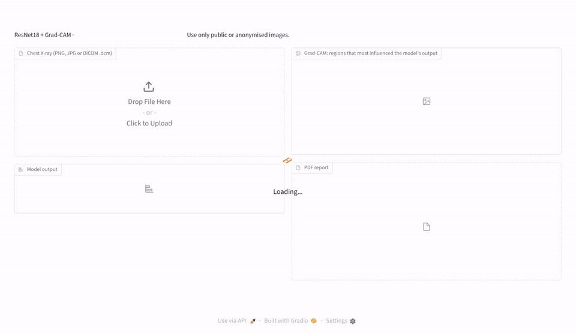
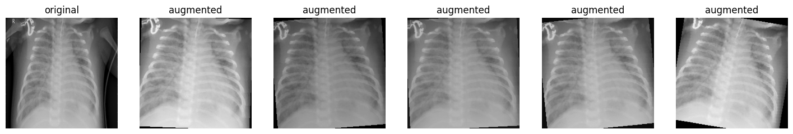
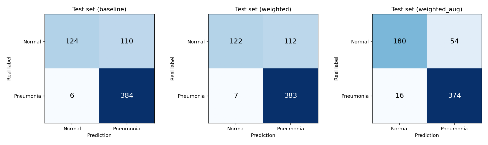
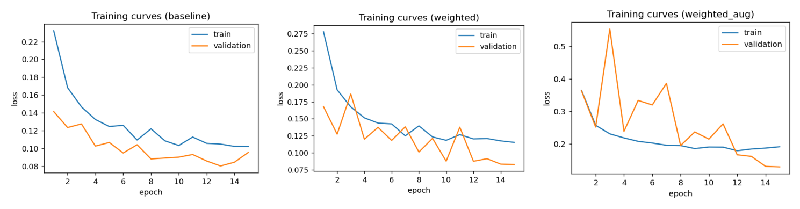
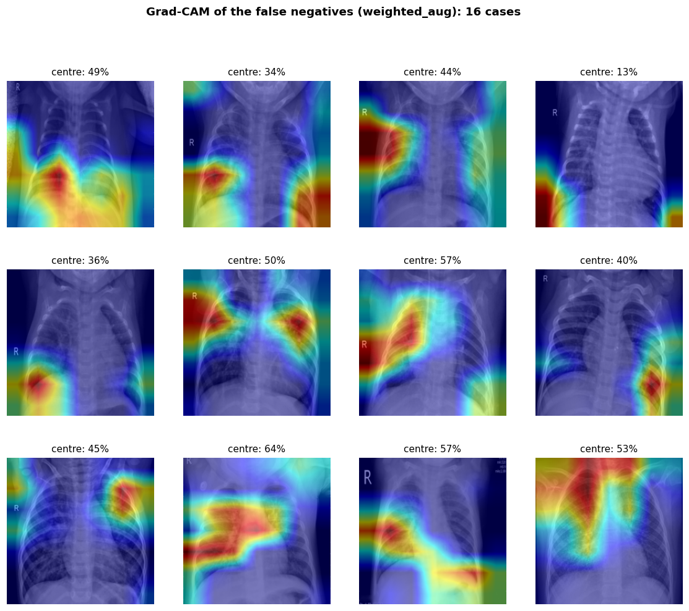
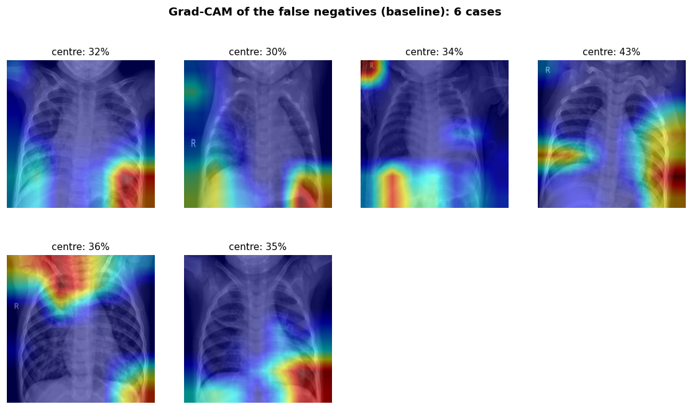

<div align="center">

# Clasificación de neumonía pediátrica en radiografías de tórax

**ResNet18 (transfer learning) · PyTorch · Grad-CAM**

</div>

Clasificador binario (**Sano / Neumonía**) de radiografías de tórax de niños de 1 a 5 años. Además de entrenar el modelo,
el objetivo es **entender cuándo y por qué falla**, revisando sus errores con Grad-CAM.

Es un proyecto de aprendizaje autónomo, con especial cuidado en evaluar el modelo de forma rigurosa
(ver [Decisiones de diseño](#decisiones-de-diseño)).

**Resultado del modelo final en test:** sensibilidad 95.9 %, especificidad 76.9 %, AUC 0.953
(ver [Resultados](#resultados)).

Incluye una [aplicación de demostración](#aplicación-de-demostración) que analiza una radiografía (PNG, JPG o DICOM),
muestra el mapa Grad-CAM y genera un informe PDF:



## Datos
*Chest X-Ray Images (Pneumonia)* (Kermany et al., 2018), publicado en Kaggle.

| Conjunto | Sanas | Neumonía |
|---|---|---|
| Entrenamiento | 1 341 | 3 875 |
| Test | 234 | 390 |

Hay casi **3 radiografías con neumonía por cada sana**. Este desequilibrio hace que el modelo tienda a decir "neumonía".

## Método
1. **Preprocesado:** redimensionado a 224 × 224 y normalización con la media y desviación de ImageNet.
2. **Validación por paciente:** la carpeta `val` oficial solo tiene 16 imágenes, así que separo un 15 % de
   entrenamiento como validación, **agrupando por paciente** para que un mismo niño no aparezca en los dos conjuntos.
3. **Modelo:** ResNet18 preentrenada en ImageNet, con las capas convolucionales congeladas y una última capa nueva de 2 salidas.
4. **Entrenamiento:** Adam (lr = 0.001), CrossEntropy y *early stopping* sobre la pérdida de validación (paciencia 4).
5. **Tres experimentos**, cambiando una sola cosa cada vez:
   * `baseline`: sin pesos por clase ni data augmentation (referencia).
   * `weighted`: añade **pesos por clase** en la función de pérdida para compensar el desequilibrio.
   * `weighted_aug`: añade **data augmentation**: recorte aleatorio, rotación de ±10° y cambios de brillo y contraste,
     sin volteo horizontal, porque cambiaría el lado del corazón. Cada época el modelo ve versiones distintas de cada
     radiografía, lo que le obliga a fijarse en la anatomía y no en detalles concretos de cada imagen.

     
6. **Evaluación:** sensibilidad, especificidad, precisión, exactitud, F1 y AUC. El modelo final se **elige con
   la validación** y el test (624 radiografías) solo se reporta, para no inflar los resultados.
7. **Grad-CAM** de **todos** los falsos negativos, más una medida sencilla de cuánta atención cae en la zona central
   de la imagen frente a los bordes.

## Resultados
Entrenado en Google Colab (GPU T4). Todas las cifras son del conjunto de **test** (624 radiografías) con umbral 0.5,
salvo la tabla de validación.

| Experimento | Sensibilidad | Especificidad | Precisión | Exactitud | F1 | AUC | FP | FN |
|---|---|---|---|---|---|---|---|---|
| `baseline` | 98.5 % | 53.0 % | 77.7 % | 81.4 % | 86.9 % | 0.936 | 110 | 6 |
| `weighted` | 98.2 % | 52.1 % | 77.4 % | 80.9 % | 86.6 % | 0.939 | 112 | 7 |
| **`weighted_aug`** | 95.9 % | **76.9 %** | **87.4 %** | **88.8 %** | **91.4 %** | **0.953** | **54** | 16 |

**Validación** (≈ 780 imágenes separadas por paciente), que es con lo que se elige el modelo:

| Experimento | Sensibilidad | Especificidad | AUC | Exactitud equilibrada |
|---|---|---|---|---|
| `baseline` | 98.1 % | 92.1 % | 0.995 | 95.1 % |
| `weighted` | 97.8 % | 92.1 % | 0.995 | 95.0 % |
| `weighted_aug` | 95.6 % | 95.8 % | 0.989 | **95.7 %** |



### Conclusiones
1. **Modelo final: `weighted_aug`.** Es el que tiene mayor exactitud equilibrada en validación (media de sensibilidad
   y especificidad), y la elección se hace sin mirar el test.
2. **Los pesos por clase no cambian nada** (`baseline` y `weighted` son prácticamente iguales). Es decir, los falsos
   positivos no se deben al desequilibrio de clases.
3. **Hay una diferencia grande entre validación y test.** En validación la especificidad es del 92 %, pero en test baja
   al 53 %: el modelo funciona bien con imágenes parecidas a las de entrenamiento y peor con las de test, que parecen
   tener una distribución algo distinta. Sin la validación por paciente no se habría detectado.
4. **El data augmentation es lo que más ayuda:** reduce los falsos positivos a la mitad (110 → 54), sube la
   especificidad 24 puntos y reduce la diferencia validación–test de 39 a 19 puntos. A cambio, aparecen 10 falsos
   negativos más (sensibilidad 98.5 % → 95.9 %). Como también sube el AUC (0.936 → 0.953), el modelo no solo mueve el
   umbral, sino que separa mejor las dos clases.
5. Con data augmentation la pérdida de validación aún bajaba en la época 15, así que entrenar más épocas podría mejorar
   algo el resultado.



### Grad-CAM: ¿dónde mira el modelo cuando falla?
Para cada radiografía con neumonía se calcula qué fracción del mapa Grad-CAM cae en la zona central de la imagen
(quitando un margen del 15 % en cada borde). Si el mapa fuera uniforme, esa fracción sería del **49 %**.

| | `baseline` | `weighted_aug` |
|---|---|---|
| Falsos negativos | 6 | 16 |
| Atención central (todas las neumonías) | 50.7 % | 56.1 % |
| Atención central (solo falsos negativos) | **35.2 %** | **45.5 %** |

* **En los dos modelos, los falsos negativos miran menos al centro que la media** (y por debajo del 49 % de un mapa
  uniforme). En muchos de estos casos la atención está en el abdomen, el cuello o las esquinas, fuera de los pulmones.
* **El data augmentation aumenta la atención central** (50.7 % → 56.1 %): con los recortes aleatorios, la información
  de los bordes deja de ser fiable y el modelo se apoya más en la zona de los pulmones.
* Es una medida sencilla: el rectángulo central no coincide exactamente con los pulmones y el mapa Grad-CAM tiene poca
  resolución (7 × 7), así que sirve para ver tendencias, no casos concretos.



<details>
<summary>Grad-CAM de los falsos negativos de <code>baseline</code></summary>


</details>

### Limitaciones y posibles mejoras
* Un único conjunto de datos de un solo centro; no hay validación externa.
* El umbral es 0.5 fijo. Se podría ajustar en validación para recuperar sensibilidad.
* Solo se entrena la última capa. Ajustar también el último bloque de la ResNet (`layer4`) o segmentar los pulmones
  antes de clasificar son los siguientes pasos naturales.

## Decisiones de diseño
* **Validación por paciente:** la carpeta `val` oficial solo tiene 16 imágenes, insuficientes para el *early stopping*.
  Por eso uso unas 780 imágenes de entrenamiento, separadas por paciente para evitar fuga de datos.
* **Métricas completas:** con clases desequilibradas, la sensibilidad sola engaña (decir siempre "neumonía" da un 100 %).
  Por eso reporto también especificidad, precisión, exactitud y F1.
* **Un cambio por experimento:** así se puede medir el efecto de los pesos por clase y el del data augmentation por separado.
* **Grad-CAM de todos los falsos negativos**, no de un caso aislado, más una medida numérica de dónde mira el modelo.
* **Código modular** (`src/`) y un notebook solo para entrenar en Colab con GPU. Semilla fija para reproducibilidad,
  y la clave de Kaggle se lee de los *secrets* de Colab, nunca del código.

## Estructura
```
src/
├── config.py      # rutas, hiperparámetros y definición de los experimentos
├── dataset.py     # transformaciones, data augmentation, separación por paciente, DataLoaders
├── model.py       # ResNet18 con transfer learning
├── train.py       # bucle de entrenamiento con early stopping
├── evaluate.py    # métricas en test, matriz de confusión, comparación de experimentos
├── gradcam.py     # Grad-CAM de los falsos negativos y medida de atención central
├── inference.py   # análisis de una radiografía: predicción, Grad-CAM y controles de calidad
├── dicom_utils.py # lectura de DICOM con anonimización previa
└── report.py      # informe PDF a partir de una plantilla fija
app.py             # aplicación web de demostración (Gradio)
examples/          # radiografías públicas de ejemplo para la aplicación
notebooks/
└── train_colab.ipynb   # ejecuta todo en Google Colab (GPU)
```

## Aplicación de demostración
`app.py` es una interfaz web para usar el modelo entrenado de principio a fin:
1. **Entrada:** se sube una radiografía en PNG, JPG o **DICOM**. En DICOM se eliminan antes de nada los datos
   identificativos del paciente (nombre, ID, fechas, centro… y etiquetas privadas).
2. **Análisis:** el modelo devuelve la probabilidad de neumonía y el **mapa Grad-CAM** de la clase elegida (qué zonas
   han pesado más en la decisión), junto con unos controles básicos de la imagen (resolución, proporción, color, contraste).
3. **Informe PDF** generado con una plantilla fija: resultado, imágenes, controles de calidad, rendimiento del
   modelo en test y limitaciones.

> ⚠️ Demostración técnica: **no es un producto sanitario** ni apto para uso clínico. Úsala solo con imágenes públicas o anonimizadas.

### Probar la aplicación en tu ordenador
Solo hace falta Python (3.10 o superior); no necesita GPU.

```bash
git clone https://github.com/diego-dupuy/Clasificador-Neumonia-Pediatrica.git
cd Clasificador-Neumonia-Pediatrica
pip install -r requirements.txt
python app.py
```

Después abre en el navegador la dirección que aparece en la terminal (normalmente http://127.0.0.1:7860).
La primera vez, la aplicación descarga el modelo entrenado (45 MB) desde la
[Release del repositorio](https://github.com/diego-dupuy/Clasificador-Neumonia-Pediatrica/releases/tag/modelo).
Los pesos no se guardan junto al código porque Git conserva todas las versiones de cada archivo y el repositorio
crecería con cada reentrenamiento.

La carpeta `examples/` incluye 4 radiografías del test público (Kermany et al., 2018; licencia CC BY 4.0) y un DICOM
con datos de paciente **inventados**, para probar la anonimización.

## Cómo reentrenar el modelo
Abre [`notebooks/train_colab.ipynb`](notebooks/train_colab.ipynb) en Colab, elige GPU T4, añade tu clave de Kaggle
como *secret* (`KAGGLE_API_TOKEN`) y ejecuta todas las celdas. En local (con GPU):

```bash
pip install -r requirements.txt
python -m src.train --experiment weighted_aug
python -m src.evaluate --experiment weighted_aug
python -m src.gradcam --experiment weighted_aug
```

## Bibliografía
He, K., Zhang, X., Ren, S., & Sun, J. (2016). Deep residual learning for image recognition. En *Proceedings of the IEEE Conference on Computer Vision and Pattern Recognition* (pp. 770–778). https://doi.org/10.1109/CVPR.2016.90

Kermany, D. S., Goldbaum, M., Cai, W., Valentim, C. C. S., Liang, H., Baxter, S. L., McKeown, A., Yang, G., Wu, X., Yan, F., Dong, J., Prasadha, M. K., Pei, J., Ting, M. Y. L., Zhu, J., Li, C., Hewett, S., Dong, J., Ziyar, I., … Zhang, K. (2018). Identifying medical diagnoses and treatable diseases by image-based deep learning. *Cell, 172*(5), 1122–1131.e9. https://doi.org/10.1016/j.cell.2018.02.010

Mooney, P. (2018). *Chest X-Ray Images (Pneumonia)* [Conjunto de datos]. Kaggle. https://www.kaggle.com/datasets/paultimothymooney/chest-xray-pneumonia

Selvaraju, R. R., Cogswell, M., Das, A., Vedantam, R., Parikh, D., & Batra, D. (2017). Grad-CAM: Visual explanations from deep networks via gradient-based localization. En *Proceedings of the IEEE International Conference on Computer Vision* (pp. 618–626). https://doi.org/10.1109/ICCV.2017.74
